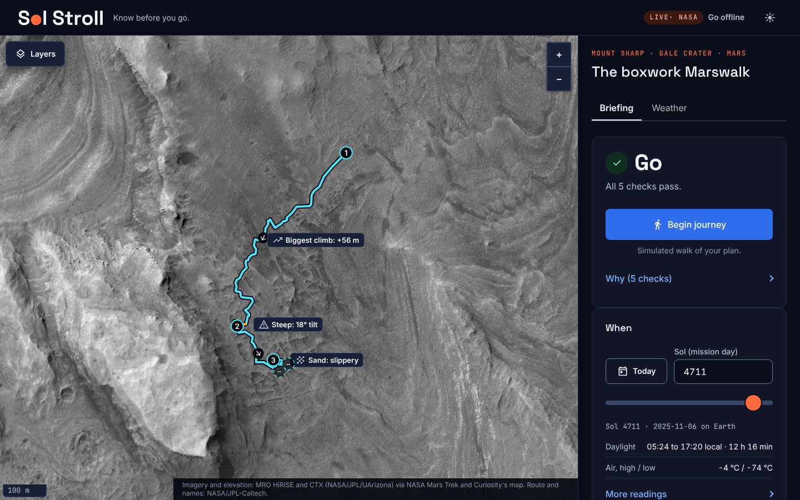

# Sol Stroll

**Know before you go.** A go / no-go briefing for one real Marswalk on Mars, built for the NASA Space Apps Challenge 2026 ("Interplanetary Survival Guide: Martian Map").

Mars maps show where to walk. Sol Stroll tells a crew whether to go. It follows NASA's Curiosity rover through the boxwork region of Mount Sharp, in Gale Crater, and answers five questions about that one walk: why go, where, when, how sure, and what if.



## What works today

- A map of the boxwork on high-resolution orbital imagery, with the path Curiosity actually drove and five science stops. It zooms from the whole crater down to the rocks.
- A plan built from stops you search for and add, in the order you choose (or the recommended shortest order). Map numbers and arrows follow that order. For each leg: each section's distance, climb, walking time and difficulty on hover or tap, the route coloured by difficulty, and callouts at steep ground, sand and the biggest climb.
- A verdict (go, caution, no-go) for any sol in Curiosity's weather record, or for today, including NASA's space weather for that date. Every reason shows its basis.
- A task list for each stop with why it matters, hazards on the route, and a packing list.
- **Live, with an offline mode:** online it reads live NASA data; with no link (as on Mars), or at the press of a button, it uses the copy stored with the site and says how recent it is (first load about 1.2 MB).
- The **safest path** between stops under **NASA's rules**: only ground Curiosity actually drove (263 rover drives joined into a network), never steeper than NASA's 20° suit limit, and the shortest within it. The verdict also applies NASA's 8-hour and 2 km walk limits.
- Map options: contour lines from NASA's Gale elevation model, colour HiRISE imagery, names of places Curiosity explored, and a latitude/longitude grid.
- Dark and light themes.

Not built yet: the orbit and ground photo comparison at each stop, and a guided replay of the 2018 dust storm.

## NASA data used

| Data | Mission and instrument | Used for |
|---|---|---|
| Orbital imagery | Mars Reconnaissance Orbiter, HiRISE, via NASA Mars Trek | The map |
| Colour orbital imagery | Mars Reconnaissance Orbiter, HiRISE colour mosaic, via NASA's Curiosity location map | The colour view |
| Elevation model | Mars Reconnaissance Orbiter, HiRISE Gale DEM, via NASA Mars Trek | Contour lines (one line per 18.6 m, see the data sources) |
| Place names | Mars Science Laboratory (Curiosity) location map | Names of places the rover explored |
| Rover waypoints | Mars Science Laboratory (Curiosity) | The route, stops, distances and climb |
| Daily weather | Curiosity REMS, provided by Centro de Astrobiología | Daylight and the seasonal comparison behind the verdict |
| Space weather | NASA DONKI (CCMC): WSA-Enlil forecasts of solar storms at Mars, solar particle events, shocks | The solar storm check in the verdict |
| Wider orbital imagery | Mars Reconnaissance Orbiter, CTX, via NASA Mars Trek | The map when zoomed out to the crater |
| Science findings | NASA/JPL-Caltech releases and the Curiosity mission blog | What is at each stop |

Full details, limits and usage terms are in [`docs/DATA_SOURCES.md`](docs/DATA_SOURCES.md). The weather feed is labelled by its provider as intended for outreach purposes only.

## What is measured, derived and assumed

- **Measured by NASA missions:** imagery, rover positions and elevations, daily temperatures, sunrise and sunset.
- **Derived by us:** distances along the path, climb, how unusual a sol is for its season, and the elevation scale behind the contour lines.
- **Taken from NASA's lunar planning, because none exists for Mars:** the 2 km/h walking pace and the 20° slope mark (NASA EVA-EXP-0042).
- **Assumed by us, and labelled in the page:** time spent at each stop, the daylight safety margin, the packing list, and the tasks at each stop. The slope (17°, 20°), walk length (8 h), distance (2 km) and pace (2 km/h) are NASA's lunar planning figures (EVA-EXP-0042).

NASA's own planning document says walking ranges for Mars are still "forward work", and no Mars surface suit limits are public. So the verdict uses no temperature, ultraviolet or radiation dose thresholds.

## Run it

No build step. Serve the folder and open it:

```bash
python3 -m http.server 8000
```

Then open http://localhost:8000.

Run the tests (needs Node 20 or later):

```bash
node --test tests/*.test.js
```

Rebuild the data files from NASA's servers:

```bash
python3 scripts/prepare_route.py --refresh
```

```bash
python3 scripts/prepare_weather.py --refresh
```

```bash
python3 scripts/prepare_landmarks.py --refresh
```

```bash
python3 scripts/calibrate_dem.py --refresh
```

```bash
python3 scripts/prepare_safe_paths.py
```

Rebuild the offline imagery and fonts (needs the internet once, then never again):

```bash
python3 scripts/build_offline_tiles.py
```

```bash
python3 scripts/vendor_fonts.py
```

The space weather script needs a free key from https://api.nasa.gov in `NASA_API_KEY` (see `.env.example`):

```bash
NASA_API_KEY=your-key python3 scripts/prepare_space_weather.py
```

Regenerate the style tokens after changing `DESIGN.md`:

```bash
pip install -r requirements.txt
```

```bash
python3 scripts/build_tokens.py
```

## How the code is laid out

| Path | What it holds |
|---|---|
| `index.html` | The one page |
| `src/pages/home.js` | Loads the data, holds the page state, asks the features to redraw |
| `src/features/map/` | The map, its layer panel, and the optional layers (colour imagery, contours, place names, grid) |
| `src/features/plan/` | Sections, time, difficulty, hazards, packing list, elevation profile |
| `src/features/conditions/` | The sol's conditions and the verdict |
| `src/features/theme/` | Dark and light switching |
| `src/lib/` | Mars constants, data loading, safe DOM building |
| `src/styles/` | `tokens.css` is generated from `DESIGN.md`; the rest are hand-written |
| `scripts/` | Python scripts that turn NASA downloads into the small files the page loads |
| `data/stops.json` | The five stops, written by hand with sources |
| `data/raw/`, `data/processed/` | Untouched downloads, and the scripts' output |
| `tests/` | Tests for the planning and verdict logic |
| `public/vendor/leaflet/` | Leaflet 1.9.4 (BSD 2-Clause), minified, the map library |
| `public/fonts/` | Bundled fonts and icons (OFL, Apache 2.0) |
| `data/processed/tiles/` | Bundled map imagery (about 4 MB), from `scripts/build_offline_tiles.py` |
| `docs/` | Data sources, science brief, pitch, competitive analysis |

Rules for contributing are in [`CLAUDE.md`](CLAUDE.md). The design specification is [`DESIGN.md`](DESIGN.md).

## Credits

Orbital imagery: NASA/JPL/University of Arizona (HiRISE), served by NASA Mars Trek. Rover data: courtesy NASA/JPL-Caltech. Weather: Centro de Astrobiología (CSIC-INTA) via NASA. Fonts: Space Grotesk, Inter and JetBrains Mono (SIL Open Font License).

Sol Stroll was created for the NASA Space Apps Challenge 2026. It is not affiliated with or endorsed by NASA.
